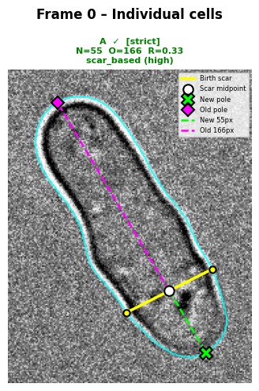
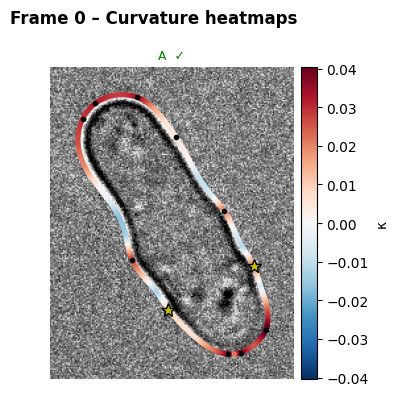
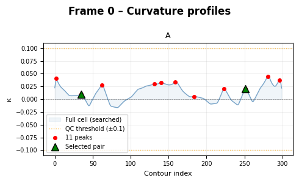
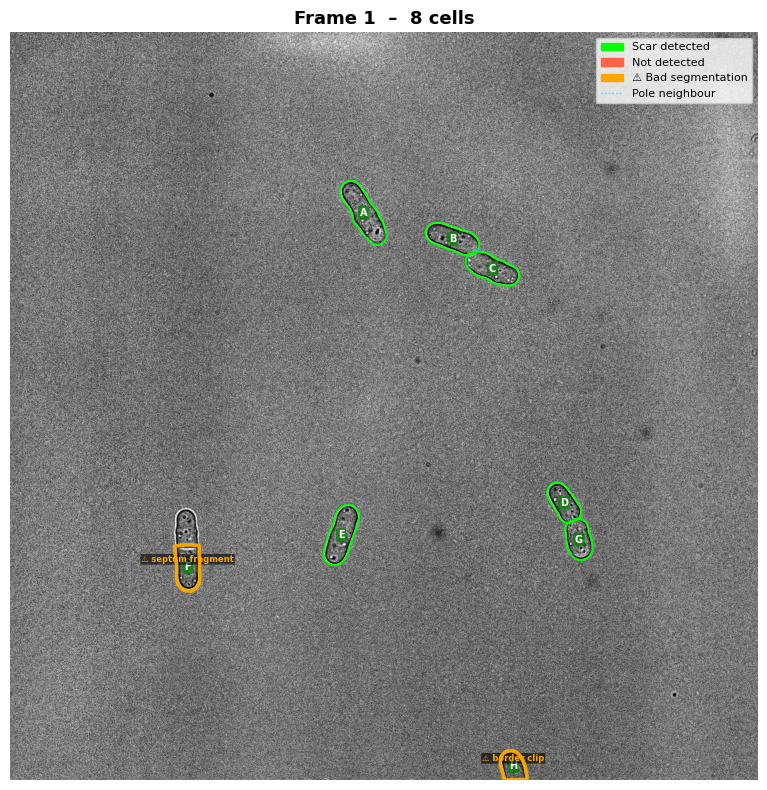

# BS-Detector
### Birth Scar Detector for *Schizosaccharomyces pombe*

Automated detection of birth scars, old/new pole identity, cell lineage tracking, and morphometric measurements in fission yeast time-lapse brightfield microscopy.



*Birth scar detection output. Yellow line: newest birth scar. Green marker: new pole. Magenta marker: old pole. Dashed lines: new-end and old-end compartment lengths.*

---

## What it does

*S. pombe* cells divide asymmetrically: each daughter inherits an **old pole** (present before the division) and one inherits a **new pole** (the freshly formed division site). The division site leaves behind a **birth scar**: a subtle ridge of elevated curvature on opposite sides of the cell wall.

BS-Detector finds these scars automatically by:

1. **Filtering** segmentation masks by area, aspect ratio, and circularity to reject debris before any tracking occurs
2. **Segmenting** cells with [Cellpose](https://github.com/MouseLand/cellpose)
3. **Measuring** every 1-px cross-section perpendicular to the cell axis,
   from each pole inward, and tracing the dark membrane line in the
   brightfield image along each contour normal (the Cellpose mask boundary
   alone smooths the scar away)
4. **Scoring** each cross-section (default `SCAR_DETECTOR_MODE = 'profile'`)
   with a few named, tunable terms, all lengths in units of cell width W:
   an expected scar distance from the new pole (grows with cell length), a
   bonus for the end touching the sibling, and the membrane-traced width and
   ridge (the scar ridge is the widest point of the new end). The
   alternative `'bilateral'` mode scores windowed membrane curvature on both
   flanks (`SCAR_BILATERAL_COMBINE` = `'min'`, `'sum'` for lopsided scars, or
   `'max'`); `'legacy'` keeps the previous mask-curvature detector
5. **Reporting** the scar as the midpoint of the best cross-section, with a
   `scar_confidence` and a `scar_needs_review` flag (low confidence, or the
   scar sits nearer the assigned old pole: `scar_pole_conflict`) so
   uncertain cells can be checked by hand. Accuracy against 80 manually
   annotated cells: 57/80 within 5 px (54/80 held out); see
   [validation/reports/scar_v3/REPORT.md](validation/reports/scar_v3/REPORT.md)
6. **Identifying** new vs. old poles via, in priority order: lineage inheritance at division, birth scar geometry, unambiguous neighbor proximity, or pole morphology as a fallback. Chain cells (both poles touching credible neighbors) are detected explicitly and fall through to scar-based assignment rather than producing a false positive
7. **Tracking** cells across frames with a Hungarian algorithm using center displacement, area change, and a curvature fingerprint. Ghost-track matching resumes lost tracks through bad-segmentation frames rather than minting new lineage names
8. **Assigning lineage names**: `A → A0 / A1 → A00 / A01 / A10 / A11 → …` where `0` always denotes the new-end daughter and `1` the old-end daughter. Daughter pole assignments are corrected immediately at division using the parent's stored pole coordinates
9. **Stabilizing** scar positions across frames via a consensus pass: each frame's selected scar (measured from the new pole) casts one vote, the most-supported position is found, and frames that deviate are corrected to a nearby candidate or interpolated along that frame's own pole-to-pole line

### Curvature analysis

Signed curvature is computed along a smoothed B-spline contour. Birth scars are scored by windowed curvature excess on opposite sides of the cell; sharp paired peaks are useful diagnostics but are not required. The curvature heatmap and profile are available for every cell to aid manual inspection and parameter tuning.



*Curvature heatmap. Red regions indicate high positive curvature; blue regions indicate low or negative curvature. Yellow stars mark the selected scar endpoints; white star marks the scar midpoint.*



*Curvature profile. Red dots: detected peaks. Green triangles: the selected scar pair. Orange dotted lines: segmentation quality threshold.*

### Segmentation quality control

Cellpose occasionally produces artifact segmentations, most commonly a septum fragment (one half of a dividing cell) or a cell whose mask clips the image boundary. Both produce pathological curvature spikes well above the range of a healthy contour. BS-Detector flags these automatically with an orange overlay so they can be reviewed or excluded without disrupting the rest of the analysis.



*Orange outlines indicate cells flagged by the segmentation quality check. Green outlines are clean detections.*

---

## Output

For each frame and each cell, BS-Detector produces:

| Column | Description |
|---|---|
| `cell_name` | Lineage-encoded name (`A`, `A0`, `A01` …) |
| `frame` | Frame index |
| `length` | Pole-to-pole distance [px] |
| `width_centroid` | Width perpendicular to long axis at cell center [px] |
| `width_scar` | Distance between the two scar endpoints [px] |
| `new_end_length` | Scar midpoint → new pole [px] |
| `old_end_length` | Scar midpoint → old pole [px] |
| `area` | Cell area [px²] |
| `scar_detected` | True / False |
| `scar_source` | `raw`, `corrected`, or `interpolated` — how the final scar position was determined |
| `scar_stable` | False if more than `SCAR_INSTABILITY_FRACTION` of the cell's frames were corrected or interpolated |
| `seg_quality` | `ok`, `border_clip`, or `septum_fragment` |
| `pole_method` | How poles were assigned (`lineage`, `scar_based`, `neighbor_proximity`, `neighbor_poles`, `morphology`) |
| `pole_confidence` | Confidence level of pole assignment |

Cells with `seg_quality = border_clip` are excluded from the CSV entirely (incompletely segmented). All other cells are included regardless of quality flag.

---

## Sample dataset

A 5-frame sample dataset is bundled at `data/sample/sample.h5` for testing and demonstration without needing your own data. The Colab notebook uses it by default; no configuration required for a first run.

---

## Installation & usage (Google Colab)

Open [`notebooks/BS_Detector_Colab.ipynb`](notebooks/BS_Detector_Colab.ipynb) in Colab.

**Step 1** — the first two cells install dependencies and clone this repo automatically.  
**Step 2** — the configuration cell defaults to the bundled sample dataset. Change `cfg.H5_FILE_PATH` to your own HDF5 file on Google Drive when you have real data. That is the only cell most users ever need to edit.  
**Step 3** — run the remaining cells top-to-bottom.

Results are saved to `cfg.OUTPUT_DIR` (a Google Drive folder for real data, or `/content/pombe_results` for the sample run).

### Local installation

```bash
git clone https://github.com/widenerm/pombe-bs-detector.git
cd pombe-bs-detector
pip install -r requirements.txt
```

```python
from pombe_tracker.config        import Config
from pombe_tracker.pipeline      import run_pipeline
from pombe_tracker.io_utils      import load_h5_data, export_csv
from pombe_tracker.tracking      import CellTracker
from pombe_tracker.postprocessing import stabilize_scars

cfg              = Config()
cfg.H5_FILE_PATH = 'my_experiment.h5'
cfg.NUM_FRAMES   = 10

frames              = load_h5_data(cfg.H5_FILE_PATH, cfg.H5_DATASET_KEY)
tracker             = CellTracker(cfg)
results             = run_pipeline(frames, cfg, tracker=tracker)
results, report     = stabilize_scars(results, cfg)
export_csv(results, 'measurements.csv')
```

### Validation and hyperparameter tuning

Use [`notebooks/BS_Detector_Validation_Tuning.ipynb`](notebooks/BS_Detector_Validation_Tuning.ipynb)
to validate detector changes against manually collected ground truth. The
notebook caches Cellpose labels once, then sweeps curvature-window, pole-cap,
width, angle, and endpoint-offset parameters without rerunning segmentation.
See [`validation/GROUND_TRUTH_PROTOCOL.md`](validation/GROUND_TRUTH_PROTOCOL.md)
and [`validation/ground_truth_template.csv`](validation/ground_truth_template.csv)
for the measurement format.

Sparse TIFF packages can be converted for the notebook with:

```bash
python scripts/convert_validation_tifs_to_h5.py \
    validation/package_for_carmen \
    --output validation/h5_for_drive/carmen_package_1
```

The converter accepts either a package directory or ZIP file and preserves
the original movie frame numbers in each H5's `frame_numbers` dataset.

---

## Repository structure

```
pombe-bs-detector/
├── data/
│   └── README.md          ← dataset description and format notes
│   └── sample/
│       ├── sample.h5          ← bundled 5-frame test dataset 
├── docs/
│   └── figs/                  example figures
├── notebooks/
│   └── BS_Detector_Colab.ipynb   ← start here
├── pombe_tracker/
│   ├── config.py          central configuration (all tunable parameters)
│   ├── geometry.py        curvature, PCA, width / length measurements
│   ├── detection.py       BirthScarDetector — prominence + perpendicularity scoring
│   ├── poles.py           new/old pole assignment; chain-cell detection
│   ├── segmentation.py    Cellpose wrapper
│   ├── tracking.py        Hungarian tracker + lineage naming + ghost-track matching
│   ├── pipeline.py        CellProcessor, lineage pole correction, run_pipeline
│   ├── visualization.py   all plotting functions
│   ├── postprocessing.py  consensus-based temporal scar stabilization
│   └── io_utils.py        HDF5 loading, CSV export
├── requirements.txt
├── .gitignore
└── README.md
```

---

## Key parameters

| Parameter | Default | Effect |
|---|---|---|
| `SCAR_DETECTOR_MODE` | `'profile'` | `'profile'`, `'bilateral'`, or `'legacy'` (previous curvature detector) |
| `SCAR_PRIOR_OFFSET`, `SCAR_PRIOR_SLOPE` | −0.740, 0.374 | Expected scar distance from the new pole: d/W = offset + slope·(length/W) |
| `SCAR_PRIOR_SD` | 0.194 | Spread of that expectation (in widths); loosen for unusual morphologies |
| `SCAR_HINT_WEIGHT` | 2.01 | Preference for the pole touching the sibling cell |
| `SCAR_MEMBRANE_WIDTH_WEIGHT`, `SCAR_MEMBRANE_RIDGE_WEIGHT` | 44.2, 18.3 | Weight of the image-traced membrane width and ridge |
| `SCAR_CONFIDENCE_FLAG` | 0.5 | Below this confidence a cell gets `scar_needs_review = True` |
| `SCAR_BILATERAL_COMBINE` | `'min'` | Bilateral mode: how the two flanks combine (`'min'`, `'sum'`, `'max'`) |
| `SCAR_BILATERAL_WINDOW_W` | 0.15 | Bilateral mode: axial averaging window, in cell widths |

Re-fit the profile weights for a new strain or mutant from a few dozen
annotated cells with `python -m validation.scar_fit cells.pkl` (see the
v3 report). Legacy-mode parameters (`SCAR_CURVATURE_WINDOW`,
`SCAR_CAP_EXCLUSION`, ...) are documented in `config.py`.

| Parameter | Default | Effect |
|---|---|---|
| `ASPECT_RATIO_MIN` | 1.5 | Minimum major/minor axis ratio; increase to reject shorter debris |
| `MAX_CIRCULARITY` | 0.85 | Maximum 4π·area/perimeter²; decrease to be stricter about rod shape |
| `POLE_PROXIMITY_THRESHOLD` | 100 px | Max tip-to-tip distance to call two cells neighbors |
| `NEIGHBOR_HIGH_CONFIDENCE_DIST` | 75 px | Distance below which a neighbor match is considered high-confidence |
| `MAX_TRACKING_DISTANCE` | 80 px | Max center displacement between frames |
| `GHOST_FRAMES` | 3 | Frames a lost track is kept alive before being discarded |
| `CURVATURE_QUALITY_THRESHOLD` | 0.10 | Max curvature before a cell is flagged as a segmentation artifact |
| `SCAR_STABILITY_THRESHOLD` | 0.12 | Max scar position shift (normalized) before a frame is corrected |
| `SCAR_INSTABILITY_FRACTION` | 0.30 | Fraction of corrected/interpolated frames before `scar_stable = False` |

All parameters are documented in [`pombe_tracker/config.py`](pombe_tracker/config.py).

## License

MIT

### Sparse v2 scar validation (no tracking)

Use [the batch validation notebook](notebooks/BS_Detector_Validation_Tuning.ipynb)
or run the equivalent command from the repository root:

```bash
python -m validation.scar_batch \
  --h5-dir validation/h5_for_drive/carmen_package_2 \
  --gt validation/package_for_carmen_2/ground_truth_template_cr_v2.csv \
  --anchors validation/reports/scar_v2/cell_anchors.csv \
  --cache validation/runs/scar_v2/cache \
  --out validation/runs/scar_v2/baseline \
  --segment-missing --gallery
python -m validation.scar_ablations
python -m unittest discover -s tests -v
```

The cache records image hashes and segmentation model provenance, with separate
paths for each video and original frame number. The default inference batch size
is 1 to limit GPU memory; image resolution and segmentation thresholds remain
unchanged. Remove the cache deliberately when changing the segmentation model.
The independent cell anchors are historical pole midpoints from the original
blinded-package run, not manual scar positions. On another dataset, supply a
matching anchor CSV or omit `--anchors` for conditional GT-containment matching.

Outputs include every cell prediction, one error row per annotation, per-video
and combined metrics, the exact cells outside 5 pixels, and a diagnostic gallery
with every candidate and its score components. `recall_5px` includes missed
predictions; `detection_recall` measures only prediction presence. Precision at
5 pixels is conditional on annotated cells. Unannotated cells and blank,
uncertain scar annotations are not treated as negatives.

The [audit](validation/reports/scar_v2/AUDIT.md) documents the comparison design.
Raw data, segmentation caches and gallery images stay in ignored run directories.

For Google Colab, use
[the dedicated Colab notebook](notebooks/BS_Detector_Validation_Colab.ipynb).
Build its companion code-and-mask bundle from the current working tree with
`python validation/build_colab_handoff.py`. The ZIP and a notebook copy are saved
under ignored `validation/runs/scar_v2/colab/`; no H5 files, TIFFs, PNGs or model
weights are bundled. Rebuild after code changes so the notebook's bundle hash
matches. Upload both files to Colab, select a GPU runtime, mount Drive, and set
the H5 folder in the notebook. All four videos run in one batch and masks and
results persist in Drive. Compatible bfloat16 GPUs can reuse the saved Mac masks;
other GPUs use a separate float32 cache. Device differences are recorded and
model hashes, precision, package releases and inference settings remain checked.
The notebook downloads a small review ZIP after producing baseline metrics,
targeted ablations, the experimental comparison, and complete failure galleries.
