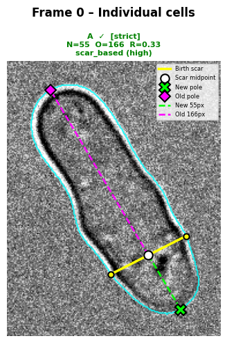
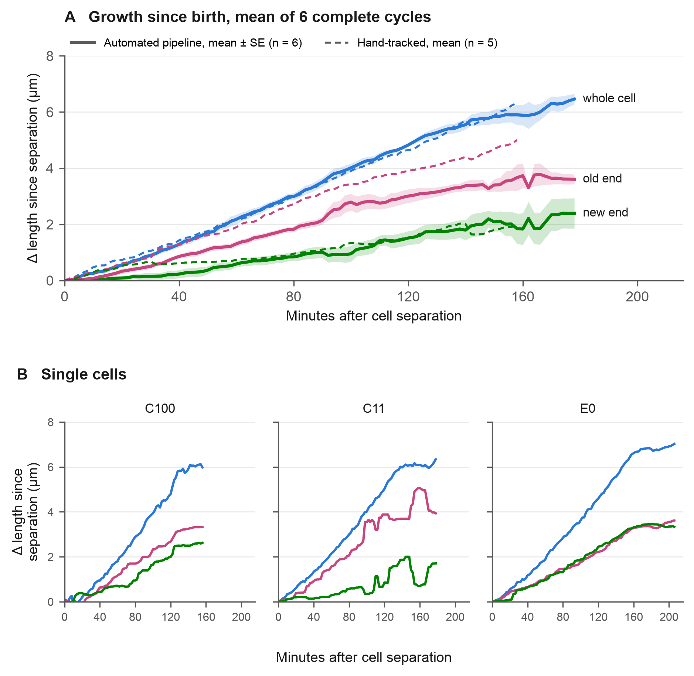

# BS-Detector

**Birth scars, pole identity and polar growth of fission yeast, from ordinary brightfield time-lapse movies.**

[](https://github.com/widenerm/pombe-bs-detector/actions/workflows/tests.yml)
[](https://colab.research.google.com/github/widenerm/pombe-bs-detector/blob/main/notebooks/BS_Detector_Colab.ipynb)
[](LICENSE)

*Schizosaccharomyces pombe* grows only at its two ends. After a cell is born, it grows
from its **old end** first and only later switches on growth at its **new end**
(new-end take-off, NETO). Measuring each end separately requires knowing which end is
which, and the only mark of that in a brightfield image is the **birth scar**: a faint
ridge left on the cell wall by the division that made the cell. Following one cell from
birth by hand takes 10–40 minutes, so hand-tracked studies stop at a handful of cells.

BS-Detector finds the birth scar in every cell in every frame, assigns the old and new
poles, follows each cell through its divisions, and writes the length of each end over
time, so every cell in a movie can be measured.

<p align="center">

</p>

*One cell: birth scar (yellow), its midpoint (white), new pole (green), old pole
(magenta), and the new-end and old-end lengths (dashed).*

## How well it works

**Scar position, single frames.** Two lab experts annotated the same cells
independently. Neither saw the other's points until both had finished. BS-Detector's
weights were fitted to Annotator A's labels; Annotator B's were never used for fitting.

| 77 annotations in 61 cells, 4 movies | Within 5 px (0.32 µm) | Median error |
|---|---:|---:|
| Annotator A vs Annotator B (two experts) | 61 (79%) | 3.4 px |
| **BS-Detector vs Annotator B** | **61 (79%)** | **2.8 px** |
| BS-Detector vs Annotator A (labels it was fitted on) | 56 (73%) | 3.5 px |
| First version: curvature of the segmented outline, vs Annotator B | 18 (23%) | 8.0 px |

- **The detector reads the image, not just the outline.** Segmentation smooths the
  scar away. The first version searched segmented outlines for curvature and placed
  only 18 of 77 scars within 5 px. The current detector traces the membrane line in
  the brightfield image across every cross-section near each pole, and scores each
  candidate with a few named terms. Uncertain cells are flagged for review rather
  than forced.
- **These are development cells, so the numbers are likely optimistic.** A
  **blind test** is under way on 135 cells from eight movies (two imaging days) that
  were never used in development. The detector was frozen before anyone ran it on
  those cells, and the result will be reported here whatever it is
  ([validation/test_set/](validation/test_set/README.md)).

**Growth curves.** In two strains (wild type, and *rgf1*Δ *gpd1*Δ), whole-cell growth
since birth matches hand tracking within one standard error at every time compared. The
split between the two ends is less settled. Against a second expert's through-time
tracks of 6 cells, the new-end length has a mean error of 0.3–0.4 µm. By late in the
cycle the old end has grown 1–1.3 µm less than in hand tracking; part of that gap is
because the hand-tracked ends add up to more than the whole cell.
[Details and caveats](docs/VALIDATION.md).

<p align="center">

</p>

*Growth since birth in one 8-hour wild-type movie. (A) Six complete cell cycles,
pipeline mean ± SE (solid) and hand-tracked cells from another movie (dashed).
(B) Three single cells.*

## Quick start

**No install (Google Colab, free GPU).** Open
[`notebooks/BS_Detector_Colab.ipynb`](notebooks/BS_Detector_Colab.ipynb) with the
Colab badge above. Paste the Google Drive path of a movie and click *Run all*. The
notebook runs on the bundled sample movie if you don't give one.

**On your own computer:**

```bash
pip install "bs-detector @ git+https://github.com/widenerm/pombe-bs-detector"
bsd info  my_movie.nd2                    # positions, channels, pixel size, frame interval
bsd run   my_movie.nd2 --out runs/my_movie
```

`bsd run` does four steps. Each can also be run on its own, and each picks up where it
stopped if interrupted:

| Step | Command | Writes |
|---|---|---|
| Read the movie (resampled to 0.0647 µm/px if needed) | `bsd prepare` | `run.json`, `frames.h5` |
| Segment every frame with Cellpose-SAM (the GPU step) | `bsd segment` | `masks/` |
| Track cells, assign poles, find birth scars | `bsd track` | `measurements.csv`, `qc/` |
| Growth curves of every complete cell cycle | `bsd growth` | `growth/` |

Inputs: Nikon `.nd2`, SlideBook `.sldy`, `.tif` stacks or `.h5`. Segmentation takes
roughly 15–40 s per 2304 × 2304 frame on an NVIDIA GPU and about 90 s on an Apple M2.
A cluster array job splits it across GPUs ([docs/HPC.md](docs/HPC.md)). The other
steps run on a laptop CPU.

The [user guide](docs/USER_GUIDE.md) covers inputs, every output column, the review
flags and how to compare with hand tracking.

## Septin localization vs cell-outline curvature

The same segmentation and contour code measures fluorescence along each cell outline
on paired brightfield and fluorescence stills. Within-cell association tests treat each
cell as the unit and use circular-shift nulls:

```bash
bsd septin run path/to/nd2_pairs --out runs/septin_080724
```

See [docs/SEPTIN.md](docs/SEPTIN.md).

## How it works

1. **Segment** each frame with [Cellpose-SAM](https://github.com/MouseLand/cellpose)
   (pinned weights, float32), then reject debris by area, aspect ratio and
   circularity.
2. **Find the birth scar.** For every 1-px cross-section near each pole, trace the dark
   membrane line in the brightfield image along the outline normals. Score each
   cross-section with a few named terms (lengths in units of cell width): the expected
   scar distance from the new pole, which grows with cell length; a bonus for the end
   touching the sibling cell; and the traced membrane's width and ridge. The best
   cross-section's midpoint is the scar. A `scar_confidence` and a `scar_needs_review`
   flag (low confidence, or the scar nearer the end called old) mark cells to check.
3. **Assign poles** by lineage inheritance at division, scar geometry, an unambiguous
   neighbouring sibling, or pole shape as a fallback.
4. **Track** cells with Hungarian matching on position, area and outline shape. Lost
   tracks are kept alive through a few bad frames, and cells are named by lineage
   (`A` → `A0`, `A1`, where `0` is always the new-end daughter).
5. **Stabilise** the scar position across each cell's frames by consensus, correcting
   or interpolating frames that jump.
6. **Growth curves:** keep cell cycles that start and end in a real division
   (each daughter under 75% of the mother's length), last at least an hour and have no
   missed division. Then compute growth since birth and change per frame for the whole
   cell and each end.

Settings are in [`pombe_tracker/config.py`](pombe_tracker/config.py); lengths there
are in pixels at 0.0647 µm/px.

## Repository

```
pombe_tracker/       the library and the `bsd` command (cli.py, workflow.py)
septin_curve_vis/    septin intensity vs curvature
notebooks/           Colab notebooks: movies, septin, and the validation reviews
docs/                user guide, septin guide, cluster recipe, validation summary
validation/          annotation protocols, anonymized annotations, scripts and reports behind every number
tests/               unit tests and an end-to-end regression on the sample movie
data/sample/         5-frame sample movie with its saved masks
hpc/                 SLURM array job for segmentation
```

## Citation and license

If you use BS-Detector, please cite it using [CITATION.cff](CITATION.cff). MIT license.

Developed by Xan Widener in the Das and Wei labs at Boston College. Thanks to the lab
members who annotated the validation data.
